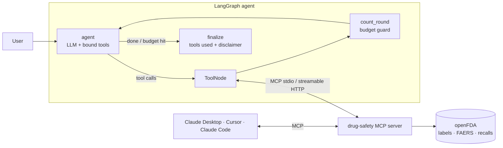

# drug-safety-mcp

**A Model Context Protocol (MCP) server that gives any AI assistant grounded access to FDA drug-safety data, plus a LangGraph agent that finds and uses its tools at runtime.**

Plug it into Claude Desktop, Claude Code, Cursor, or your own agent and ask questions like *"Is it safe to take ibuprofen with warfarin?"* The model answers from the FDA label and FAERS report data and cites where each fact came from, rather than answering from memory.



## Tools

| tool | what it returns | openFDA endpoint |
|---|---|---|
| `get_drug_label(drug, sections?)` | brand/generic names, manufacturer, boxed-warning flag, selected label sections (boxed warning, indications, contraindications, warnings, adverse reactions, drug interactions) | `/drug/label` |
| `top_adverse_events(drug, limit, serious_only)` | most-reported MedDRA reactions, report counts, total reports, and a causation caveat | `/drug/event` (FAERS) |
| `recent_recalls(drug, limit)` | recall number, class, status, reason, product | `/drug/enforcement` |
| `check_interaction(drug_a, drug_b)` | whether **either** label mentions the other drug (by generic **or brand** name), with section-tagged excerpts | `/drug/label` ×2, in parallel |

The server also exposes a **resource** (`drug-safety://about`, a data-provenance disclaimer) and a **prompt** (`safety_brief(drug)`, a cited one-page brief template).

### Engineering details

- **Structured output.** Every tool returns a pydantic model, so MCP clients receive an `outputSchema` and `structuredContent`, not just free text.
- **Query-injection safe.** Drug names are sanitised before they go into openFDA's Lucene query syntax, so input like `metformin" OR x:"*` can't change the query.
- **Resilient client.** Async httpx with retry and exponential backoff on 429/5xx, and a TTL cache. openFDA's "404 = no matches" is mapped to `found: false` instead of an error. The API key is sent but kept out of cache keys.
- **Agent guardrails.** A tool-round budget stops runaway loops, a `finalize` node appends the tools used and the disclaimer, and tool errors go back to the model instead of crashing the graph.
- **Two transports.** stdio for desktop clients, and streamable HTTP (`/mcp`) for remote or containerised deployment.

## Use it from Claude Desktop

Add to `claude_desktop_config.json` (see `examples/`):

```json
{
  "mcpServers": {
    "drug-safety": {
      "command": "uvx",
      "args": ["--from", "git+https://github.com/gopipamulapati/drug-safety-mcp", "drug-safety-mcp"]
    }
  }
}
```

## Run the agent

```bash
pip install -e ".[agent]"
export OPENAI_API_KEY=...            # any OpenAI-compatible endpoint; see .env.example
drug-safety-agent --trace "Can I take ibuprofen with warfarin?"
```

Example trace (the exact calls depend on the model):

```
-> check_interaction({'drug_a': 'ibuprofen', 'drug_b': 'warfarin'})
-> get_drug_label({'drug': 'warfarin', 'sections': ['boxed_warning', 'drug_interactions']})
...
```

No network? `--offline` (or `DRUG_SAFETY_OFFLINE=1`) serves a small **illustrative** bundled sample for warfarin, ibuprofen, and metformin. Its text is paraphrased and its counts are made up, so it's only for demos and tests.

## Serve over HTTP / Docker

```bash
docker build -t drug-safety-mcp . && docker run -p 8000:8000 drug-safety-mcp
# MCP endpoint: http://localhost:8000/mcp
```

## Tests

```bash
pip install -e ".[dev]"
pytest -q        # 17 tests, ~5 s, no network
```

- **Client:** sanitisation, retry on 429, 404 → not found, cache TTL/eviction, API key kept out of cache keys.
- **Server:** every tool, the resource, and the prompt are called through a **real MCP client session** (in-memory transport), including brand-name resolution, tool errors, and structured output schemas.
- **Agent:** the LangGraph graph talks to the MCP server as a **real stdio subprocess**, driven by a scripted chat model. This checks that data flows back from the tools, that the final answer cites the tools used, and that the tool budget stops a model that keeps calling tools.

## Layout

```
src/drug_safety_mcp/
  server.py     FastMCP server: 4 tools, 1 resource, 1 prompt, stdio/HTTP entrypoint
  openfda.py    async client: sanitising, retries, TTL cache
  agent.py      LangGraph StateGraph agent using langchain-mcp-adapters
  offline.py    httpx MockTransport serving bundled sample data
examples/       Claude Desktop config
```

> Data comes from openFDA. FAERS counts are spontaneous reports, not incidence rates, and don't establish causation. This is not medical advice.

## License

MIT
